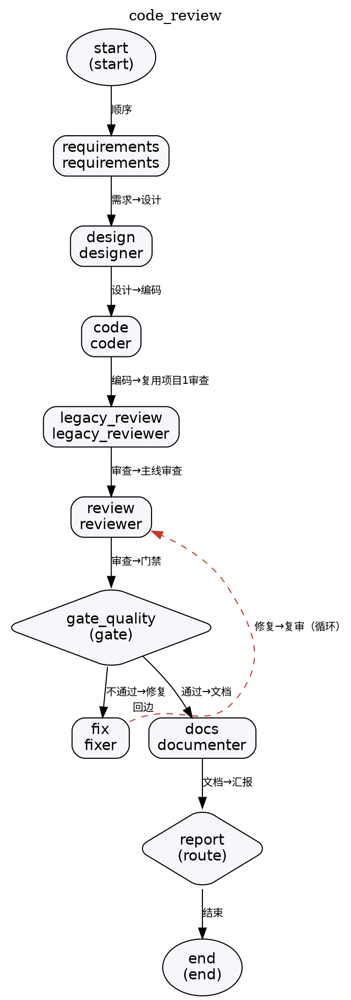
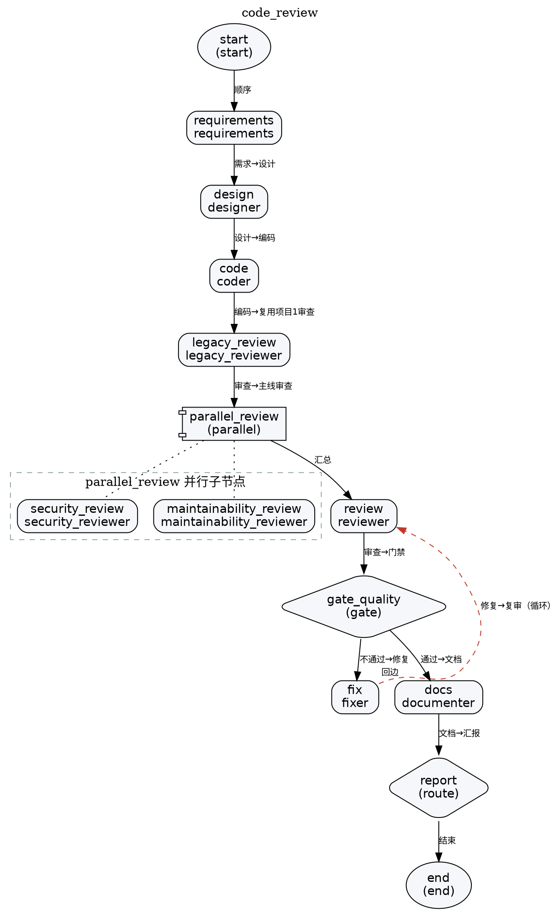
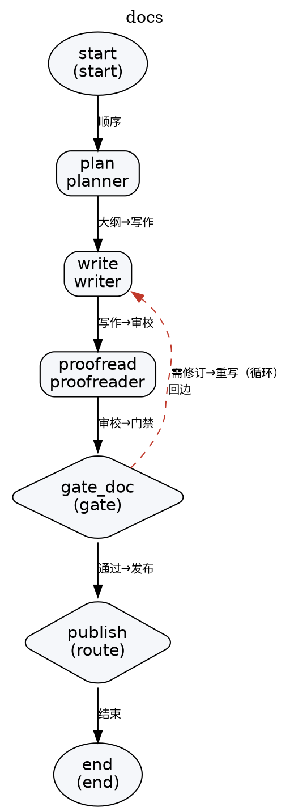

# wfa 流程拓扑（命令生成）

> 本文件由 CLI **真实生成**后整理，不是手写拓扑。重新生成的命令：
>
> ```bash
> python run.py graph --workflow code_review --format md
> python run.py graph --workflow code_review --format md --parallel-review
> python run.py graph --workflow docs --format md
> ```
>
> 下面每一节粘贴的就是上述命令的原始输出（只把节内小标题统一降一级、编号保持生成器原样，
> 并给每节加一个中文大标题，其余逐字未改）。要自己复现，见第四节。

---

## 目录

- [一、code_review 默认拓扑](#一code_review-默认拓扑)
- [二、code_review 并行审查拓扑](#二code_review-并行审查拓扑--parallel-review)
- [三、docs 流程](#三docs-流程)
- [四、怎么复核与重新生成本文件](#四怎么复核与重新生成本文件)
- [五、两条流程的对照](#五两条流程的对照)

---

# 一、code_review 默认拓扑

## 流程说明 · code_review

编码 → 审查 → 修复 的软件工程闭环流程（含需求/设计前置与文档产出）

### 1. 流程图（Mermaid）

```mermaid
flowchart TD
    start (["start<br/>(start)"])
    requirements ["requirements<br/>requirements"]
    design ["design<br/>designer"]
    code ["code<br/>coder"]
    legacy_review ["legacy_review<br/>legacy_reviewer"]
    review ["review<br/>reviewer"]
    gate_quality {"gate_quality<br/>(gate)"}
    fix ["fix<br/>fixer"]
    docs ["docs<br/>documenter"]
    report {"report<br/>(route)"}
    end (["end<br/>(end)"])
    start -->|"顺序"| requirements
    requirements -->|"需求→设计"| design
    design -->|"设计→编码"| code
    code -->|"编码→复用项目1审查"| legacy_review
    legacy_review -->|"审查→主线审查"| review
    review -->|"审查→门禁"| gate_quality
    gate_quality -->|"不通过→修复"| fix
    gate_quality -->|"通过→文档"| docs
    fix -.->|"修复→复审（循环） ↺回边"| review
    docs -->|"文档→汇报"| report
    report -->|"结束"| end
```

### 2. 节点清单

| 节点 | 类型 | Agent | 说明 | 重试 | 失败策略 | 所属循环 |
| --- | --- | --- | --- | --- | --- | --- |
| `start` | start | - | - | 0 | fail | - |
| `requirements` | agent | requirements | 需求 Agent：把任务拆成功能/非功能需求与验收标准 | 0 | fail | - |
| `design` | agent | designer | 设计 Agent：给出模块划分、接口签名与文件清单 | 0 | fail | - |
| `code` | agent | coder | 编码 Agent：生成实现与单元测试，写入工作区并本地自测 | 0 | fail | impl |
| `legacy_review` | agent | legacy_reviewer | 复用 Homework1 的代码审查 Agent（扫描器 + 25 条 AST 规则 + 工具循环） | 0 | fail | - |
| `review` | agent | reviewer | 审查 Agent：确定性规则 + 模型语义双引擎审查 | 0 | fail | - |
| `gate_quality` | gate | - | 质量门禁：决定继续修复还是收尾 | 0 | fail | - |
| `fix` | agent | fixer | 修复 Agent：按问题清单修复代码并产出 patch | 0 | fail | impl |
| `docs` | agent | documenter | 文档 Agent：依据代码与审查结论生成使用文档 | 0 | fail | - |
| `report` | route | - | 汇报节点：汇总运行结果 | 0 | fail | - |
| `end` | end | - | - | 0 | fail | - |

### 3. 边（转移条件）

| 源 | 目标 | 条件 | 标签 |
| --- | --- | --- | --- |
| `start` | `requirements` | 默认 | 顺序 |
| `requirements` | `design` | 默认 | 需求→设计 |
| `design` | `code` | 默认 | 设计→编码 |
| `code` | `legacy_review` | 默认 | 编码→复用项目1审查 |
| `legacy_review` | `review` | 默认 | 审查→主线审查 |
| `review` | `gate_quality` | 默认 | 审查→门禁 |
| `gate_quality` | `fix` | retry | 不通过→修复 |
| `gate_quality` | `docs` | pass | 通过→文档 |
| `fix` | `review` | 默认 | 修复→复审（循环） |
| `docs` | `report` | 默认 | 文档→汇报 |
| `report` | `end` | 默认 | 结束 |

### 4. 循环与分支

- 循环 `impl`：成员节点 ['code', 'fix']，最大迭代 3 次
- 条件分支：见第 3 节中带 `when` 的边（`retry` 回边 / `pass` 收尾边）

### 5. Graphviz DOT（可选）



---

# 二、code_review 并行审查拓扑（--parallel-review）

## 流程说明 · code_review

编码 → 审查 → 修复 的软件工程闭环流程（含需求/设计前置与文档产出）

### 1. 流程图（Mermaid）

```mermaid
flowchart TD
    start (["start<br/>(start)"])
    requirements ["requirements<br/>requirements"]
    design ["design<br/>designer"]
    code ["code<br/>coder"]
    legacy_review ["legacy_review<br/>legacy_reviewer"]
    parallel_review {{"parallel_review<br/>(parallel)"}}
    subgraph sg_parallel_review["parallel_review / 并行子节点"]
        direction LR
        parallel_review__security_review ["security_review<br/>security_reviewer"]
        parallel_review__maintainability_review ["maintainability_review<br/>maintainability_reviewer"]
    end
    parallel_review -.-> parallel_review__security_review
    parallel_review -.-> parallel_review__maintainability_review
    review ["review<br/>reviewer"]
    gate_quality {"gate_quality<br/>(gate)"}
    fix ["fix<br/>fixer"]
    docs ["docs<br/>documenter"]
    report {"report<br/>(route)"}
    end (["end<br/>(end)"])
    start -->|"顺序"| requirements
    requirements -->|"需求→设计"| design
    design -->|"设计→编码"| code
    code -->|"编码→复用项目1审查"| legacy_review
    legacy_review -->|"审查→主线审查"| parallel_review
    parallel_review -->|"汇总"| review
    review -->|"审查→门禁"| gate_quality
    gate_quality -->|"不通过→修复"| fix
    gate_quality -->|"通过→文档"| docs
    fix -.->|"修复→复审（循环） ↺回边"| review
    docs -->|"文档→汇报"| report
    report -->|"结束"| end
```

### 2. 节点清单

| 节点 | 类型 | Agent | 说明 | 重试 | 失败策略 | 所属循环 |
| --- | --- | --- | --- | --- | --- | --- |
| `start` | start | - | - | 0 | fail | - |
| `requirements` | agent | requirements | 需求 Agent：把任务拆成功能/非功能需求与验收标准 | 0 | fail | - |
| `design` | agent | designer | 设计 Agent：给出模块划分、接口签名与文件清单 | 0 | fail | - |
| `code` | agent | coder | 编码 Agent：生成实现与单元测试，写入工作区并本地自测 | 0 | fail | impl |
| `legacy_review` | agent | legacy_reviewer | 复用 Homework1 的代码审查 Agent（扫描器 + 25 条 AST 规则 + 工具循环） | 0 | fail | - |
| `parallel_review` | parallel | - | 并行审查：安全线 + 可维护性线同时执行 | 0 | fail | - |
| `review` | agent | reviewer | 审查 Agent：汇总并行审查结论并复核（规则 + 模型双引擎） | 0 | fail | - |
| `gate_quality` | gate | - | 质量门禁：决定继续修复还是收尾 | 0 | fail | - |
| `fix` | agent | fixer | 修复 Agent：按问题清单修复代码并产出 patch | 0 | fail | impl |
| `docs` | agent | documenter | 文档 Agent：依据代码与审查结论生成使用文档 | 0 | fail | - |
| `report` | route | - | 汇报节点：汇总运行结果 | 0 | fail | - |
| `end` | end | - | - | 0 | fail | - |

### 3. 边（转移条件）

| 源 | 目标 | 条件 | 标签 |
| --- | --- | --- | --- |
| `start` | `requirements` | 默认 | 顺序 |
| `requirements` | `design` | 默认 | 需求→设计 |
| `design` | `code` | 默认 | 设计→编码 |
| `code` | `legacy_review` | 默认 | 编码→复用项目1审查 |
| `legacy_review` | `parallel_review` | 默认 | 审查→主线审查 |
| `parallel_review` | `review` | 默认 | 汇总 |
| `review` | `gate_quality` | 默认 | 审查→门禁 |
| `gate_quality` | `fix` | retry | 不通过→修复 |
| `gate_quality` | `docs` | pass | 通过→文档 |
| `fix` | `review` | 默认 | 修复→复审（循环） |
| `docs` | `report` | 默认 | 文档→汇报 |
| `report` | `end` | 默认 | 结束 |

### 4. 循环与分支

- 循环 `impl`：成员节点 ['code', 'fix']，最大迭代 3 次
- 条件分支：见第 3 节中带 `when` 的边（`retry` 回边 / `pass` 收尾边）

### 5. Graphviz DOT（可选）



---

# 三、docs 流程

## 流程说明 · docs

主题 → 大纲 → 内容 → 审校 的内容创作流程（规划/写作/审校三个 Agent）

### 1. 流程图（Mermaid）

```mermaid
flowchart TD
    start (["start<br/>(start)"])
    plan ["plan<br/>planner"]
    write ["write<br/>writer"]
    proofread ["proofread<br/>proofreader"]
    gate_doc {"gate_doc<br/>(gate)"}
    publish {"publish<br/>(route)"}
    end (["end<br/>(end)"])
    start -->|"顺序"| plan
    plan -->|"大纲→写作"| write
    write -->|"写作→审校"| proofread
    proofread -->|"审校→门禁"| gate_doc
    gate_doc -.->|"需修订→重写（循环） ↺回边"| write
    gate_doc -->|"通过→发布"| publish
    publish -->|"结束"| end
```

### 2. 节点清单

| 节点 | 类型 | Agent | 说明 | 重试 | 失败策略 | 所属循环 |
| --- | --- | --- | --- | --- | --- | --- |
| `start` | start | - | - | 0 | fail | - |
| `plan` | agent | planner | 规划 Agent：产出章节大纲 | 0 | fail | - |
| `write` | agent | writer | 写作 Agent：按大纲产出正文（返工时叠加审校意见） | 0 | fail | doc |
| `proofread` | agent | proofreader | 审校 Agent：检查事实、结构与表述 | 0 | fail | - |
| `gate_doc` | gate | - | 文档门禁：决定返工或发布 | 0 | fail | - |
| `publish` | route | - | 发布节点：汇总最终文档 | 0 | fail | - |
| `end` | end | - | - | 0 | fail | - |

### 3. 边（转移条件）

| 源 | 目标 | 条件 | 标签 |
| --- | --- | --- | --- |
| `start` | `plan` | 默认 | 顺序 |
| `plan` | `write` | 默认 | 大纲→写作 |
| `write` | `proofread` | 默认 | 写作→审校 |
| `proofread` | `gate_doc` | 默认 | 审校→门禁 |
| `gate_doc` | `write` | retry | 需修订→重写（循环） |
| `gate_doc` | `publish` | pass | 通过→发布 |
| `publish` | `end` | 默认 | 结束 |

### 4. 循环与分支

- 循环 `doc`：成员节点 ['write']，最大迭代 2 次
- 条件分支：见第 3 节中带 `when` 的边（`retry` 回边 / `pass` 收尾边）

### 5. Graphviz DOT（可选）



---

# 四、怎么复核与重新生成本文件

第 1~3 节的文本**逐字节**等于下面三条命令的输出：

```bash
python run.py graph --workflow code_review --format md                          # 第 1 节
python run.py graph --workflow code_review --format md --parallel-review        # 第 2 节
python run.py graph --workflow docs --format md                                 # 第 3 节
```

一次写盘（也是本文件的生成方式之一）：

```bash
python run.py graph --workflow code_review --format md --out docs/FLOW.md
```

其它等价格式与用途：

| 命令 | 输出 | 用途 |
| --- | --- | --- |
| `python run.py graph -w code_review --format mermaid` | Mermaid `flowchart TD` | 贴进 GitHub / Typora / mermaid.live |
| `python run.py graph -w code_review --format dot` | Graphviz DOT | `dot -Tpng flow.dot -o flow.png` |
| `python run.py graph -w docs --format md` | 完整流程文档 | 本文第 3 节 |
| `python run.py graph -w code_review --format md --parallel-review` | 并行版拓扑 | 本文第 2 节 |

同样的拓扑也能在 Web 界面看到：`GET /api/workflows` 返回每个流程的 `nodes` / `edges` / `mermaid`，
与本文同源（都来自 `Workflow.to_mermaid()` 与 `wfa.report.render_flow_document()`）。

---

# 五、两条流程的对照

| 维度 | `code_review` | `docs` |
| --- | --- | --- |
| 领域 | 软件工程（需求 → 设计 → 代码 → 审查 → 修复） | 内容创作（主题 → 大纲 → 内容 → 审校 → 发布） |
| 顶层节点数 | 11（默认）/ 12（`--parallel-review`） | 7 |
| 参与 Agent | `requirements` `designer` `coder` `legacy_reviewer` `reviewer` `fixer` `documenter`；并发版另加 `security_reviewer` `maintainability_reviewer` | `planner` `writer` `proofreader` |
| 顺序段 | `start → requirements → design → code → legacy_review` | `start → plan → write` |
| 条件分支 | `gate_quality`：`retry` → `fix`；`pass` → `docs` | `gate_doc`：`retry` → `write`；`pass` → `publish` |
| 循环（回边） | `fix → review`（`loop_of="impl"`，默认最多 3 次） | `gate_doc → write`（`loop_of="doc"`，默认最多 2 次） |
| 并行 | 并发版有 `parallel_review`（`security_review` + `maintainability_review`） | 无 |
| 复用 Homework 1 | `legacy_review` 节点绑定 `legacy_reviewer`：设了 `WFA_LEGACY_CRA_ROOT` 就调用 Homework1 的 `CodeReviewAgent`，否则回退内置规则引擎 | 无 |
| 主要产物 | 工作区源码与测试、`report/run_summary.md` | `docs/final_document.md` |
| 门禁口径 | 存在 critical/high 且未到迭代上限 → 回到修复节点 | 审校 `verdict` 非 pass 或仍有意见 → 回到写作节点 |

**回边（= 循环）怎么被识别出来**：`Workflow.back_edges()` 用 DFS 着色法找出指向祖先的边；
Mermaid 里标成 `-.->|"… ↺回边"|`，DOT 里标成 `style=dashed, constraint=false, xlabel="回边"`。
两条流程各有一条回边 —— 这是"循环"这一评分点的可视化证据。

**条件分支怎么被识别出来**：出边表里「条件」列为 `retry` / `pass` 的两条边就是分支；
节点先给出 `AgentResult.decision`，引擎再按 `docs/Design.md` 第 5 节的顺序选边。

**并行子图**：`parallel_review` 在 Mermaid 里渲染成 `subgraph`（内部 `direction LR`），
在 DOT 里渲染成 `cluster_*`；子节点用点线（`-.->`）连到容器，表示"并发执行"而非顺序流转。
并行子节点挂在容器的 `children` 上，因此**不**单独出现在「节点清单」表里（该表只列顶层节点）。

**为什么 Mermaid 边上显示的是中文而不是 `retry`**：边标签优先取 `label`，没有 `label` 才回落到 `when`；
所以 `gate_quality --retry--> fix` 显示「不通过→修复」，真正的语义条件在出边表的「条件」列里。
